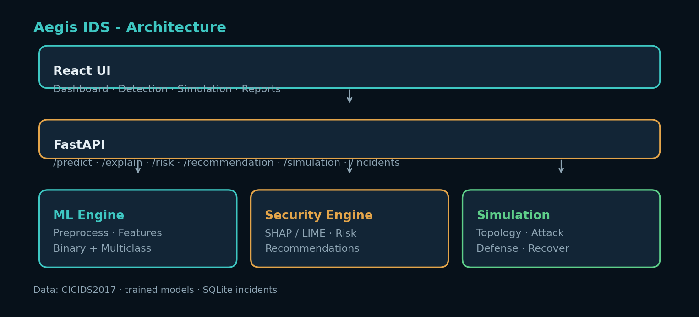
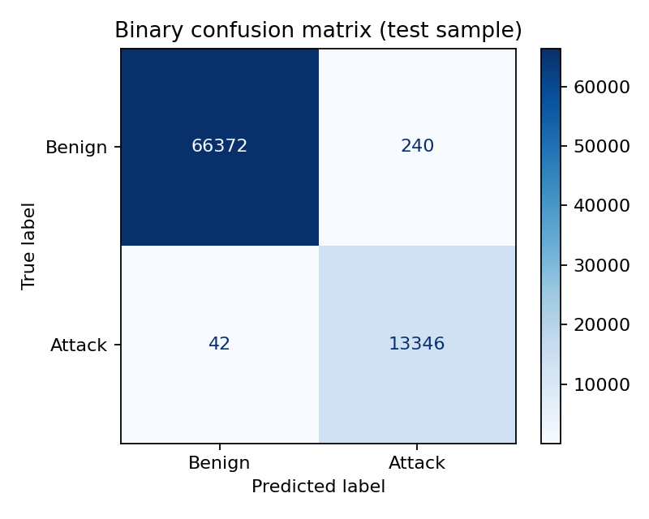
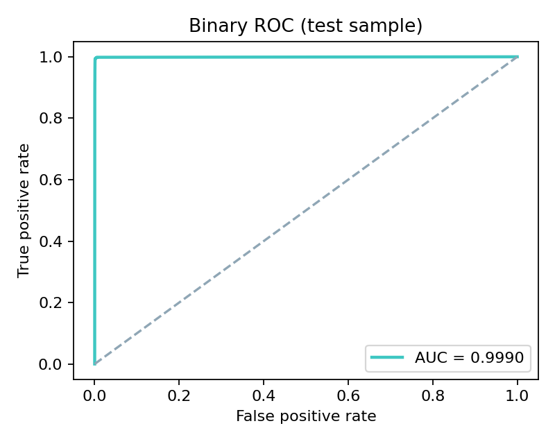
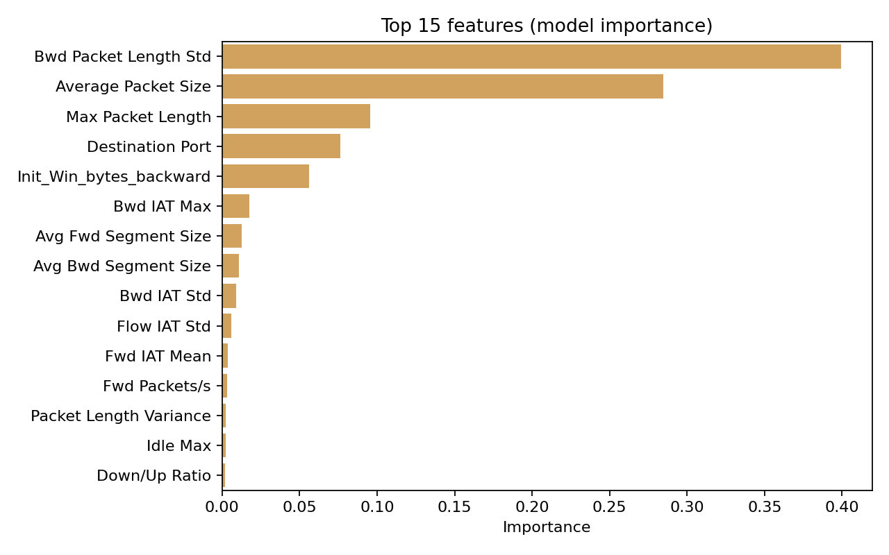

# Aegis IDS — Intelligent Intrusion Detection Platform

**One-sentence pitch:** An intelligent ML-based intrusion detection platform that detects and classifies network attacks, explains predictions, assesses risk, recommends defenses, and interactively simulates the attack-to-defense lifecycle.

**Repository:** https://github.com/Dolendra/Intelligent-Machine-Learning-Based-Intrusion-Detection-and-Attack-Defense-Simulation-System

[](https://github.com/Dolendra/Intelligent-Machine-Learning-Based-Intrusion-Detection-and-Attack-Defense-Simulation-System/actions/workflows/ci.yml)

## Dataset (not shipped in Git)

**Dataset:** CICIDS2017 (MachineLearningCVE flow CSVs).

Raw CICIDS2017 files are **intentionally excluded** from this repository (size / distribution considerations). `.gitignore` excludes `MachineLearningCVE/` and `TrafficLabelling/`. Processed Parquet under `data/processed/` is also ignored except `.gitkeep`.

**Before preprocessing / training:**

1. Download the official CICIDS2017 **MachineLearningCVE** CSV exports.
2. Place them in `MachineLearningCVE/` at the repo root (filenames like `Monday-WorkingHours.pcap_ISCX.csv`, …).
3. Then run:

```bash
python scripts/01_prepare_data.py
python scripts/02_train_models.py
```

Default training uses the full prepared dataset (`sample_frac: 1.0`) and drops rare classes (`min_class_count: 50`). Trained joblibs under `models/trained_models/` are included for demos when present.

## Quick start (local)

```bash
python -m pip install -r requirements.txt
# For freeze-reproducible installs matching metadata package versions:
# python -m pip install -r requirements-lock.txt
python scripts/01_prepare_data.py      # once (requires MachineLearningCVE/ CSVs)
python scripts/02_train_models.py      # once
python scripts/05_plot_evaluation.py   # report figures → models/trained_models/figures/

# One-click (Windows): API + UI in two terminals
powershell -File scripts/start_all.ps1

# Or manually:
# Terminal A (local development only; the API refuses to start unauthenticated unless
# AEGIS_ENV=development or test; see docs/roadmap/REMEDIATION_PLAN.md R-05)
# PowerShell: $env:AEGIS_ENV="development"   bash: export AEGIS_ENV=development
uvicorn backend.main:app --reload --port 8000
# Terminal B
cd frontend && npm install && npm run dev
```

- UI: http://127.0.0.1:5173/  
- API docs: http://127.0.0.1:8000/docs  
- Demo script: [`docs/DEMO.md`](docs/DEMO.md)
- **Final project report:** [`docs/PROJECT_REPORT.md`](docs/PROJECT_REPORT.md) (aligned to `v2.0-aegis-productionized`)
- Optional env overrides: copy `.env.example` → `.env`

### Docker (after models are trained)

`docker-compose.yml` is a **demonstration** configuration (`DEMO_MODE=true` for convenience). Production-like runs should leave `DEMO_MODE=false` (API default) and prefer `.env` / hardened settings from `.env.example`.

```bash
docker compose up --build
```

UI on port **5173**, API on **8000**, both bound to 127.0.0.1. Requires `models/trained_models/` and `data/processed/` present on the host build context.

The container runs with `AEGIS_ENV=production` and authentication **on** (remediation R-05/R-06): set
`AEGIS_AUTH_SECRET` (at least 32 random characters) and the `AEGIS_SEED_PASSWORD_<USER>` values in the git-ignored
project `.env` first; `docker compose` refuses to start without the secret.

## Architecture



```text
Network flow → preprocess → binary ML → multiclass → risk → SHAP/LIME
→ recommendation → simulation → dashboard
```

### Sample evaluation figures

<p>



</p>

> **Operating point (corrected in Phase 2).** The confusion matrix above and the historical test figures
> (F1 0.99048, recall 0.99700, FPR 0.329 %) were computed at the argmax threshold **0.5**, not at the deployed
> **0.85**. At 0.85 on the same test split the frozen Decision Tree gives F1 0.99382, recall 0.99217 and
> FPR 0.091 %, but detects only **57.1 % of Bot** (n = 389) and **37.3 % of WebAttack** (n = 429) flows
> (`research_artifacts/v11_reeval/`). The family macro-F1 0.998 assumes a perfect first stage; end-to-end
> 7-class macro-F1 at 0.85 is reported in `docs/research/RESEARCH_INTEGRITY_REPORT.md`.

Pipeline: **Network flow → preprocess → binary ML → (if attack) multiclass → risk → SHAP → recommendation → simulation → dashboard**

## v3 — Zero-day research track (Aegis-OSR)

The frozen v1.1 detector is **closed-set**: it can only answer "benign" or one of the six
families it was trained on. v3 adds **Aegis-OSR**, an open-set detector that also flags
attacks it has never seen. Its benign false-alarm rate is controlled at α **only when the calibration
traffic and the scored traffic are exchangeable** (a marginal split-conformal guarantee). It does not
hold under distribution shift: on CSE-CIC-IDS2018 the realised rate reached 36.7 % before recalibration.

```text
flow ─┬─ XGBoost (benign + known families) ── supervised evidence ─┐
      └─ kNN distance to benign traffic ─────── novelty evidence ──┴─ Fisher fusion
         → split-conformal p-value ≤ α (benign FPR ≤ α) → BENIGN | known family | UNKNOWN-ATTACK | ZERO-DAY-ANOMALY
```

* **Research protocols:** leave-one-attack-family-out, a *true* temporal split (the old
  script-25 "temporal holdout" re-scored models that had trained on Friday rows), and
  CICIDS2017 → **CSE-CIC-IDS2018** transfer, with 5 seeds, 95% CIs and Wilcoxon tests.
* **Label-light adaptation:** re-calibrating on a few thousand benign flows from a new day or
  network **re-targets the alert threshold** without retraining. It does not guarantee the target
  rate: after recal@2000 the realised FPR still ranged 0.00 %–8.84 % across 2018 days (seed means),
  and fused Aegis-OSR detected fewer known attacks than recalibrated closed-set XGB
  (see `docs/research/RESEARCH_INTEGRITY_REPORT.md`).
* **Production Zero-Day Gate** (advisory): every `/api/predict` response now carries a
  `zero_day` verdict; the frozen v1.1 decision is never changed. Under the default `frozen`
  incident policy, gate-only alerts are recorded as *Zero-Day Candidates* and raise no incident.
  On 82,111 benign flows held out from both models, the benign incident rate is 0.077 % (`frozen`),
  0.896 % (`gate`) and 0.934 % (`union`) (`research_artifacts/v11_reeval/v11_policy_alert_rates.json`).
* **New UI:** Live Traffic Monitor (real-time replay of held-out flows through both detectors),
  Zero-Day Lab (interactive gate + α trade-off) and Research Lab (all results with CIs).

| Doc / artifact | Purpose |
|---|---|
| [`docs/research/AEGIS_OSR.md`](docs/research/AEGIS_OSR.md) | Method, protocols, threats to validity, related work |
| [`docs/research/RESULTS.md`](docs/research/RESULTS.md) | Auto-generated tables + figures (`scripts/55_research_figures.py`) |
| `research/` | Research package (data, conformal, open-set model, protocols, serving) |
| `research_artifacts/` | Records, summaries, figures, replay pool |
| `models/trained_models/aegis_osr/` | Exported Zero-Day Gate (torch-free) |

```bash
python scripts/50_openset_experiments.py --protocol loafo temporal cross --seeds 1 2 3 4 5
python scripts/53_summarize_research.py && python scripts/55_research_figures.py
python scripts/51_train_zero_day_gate.py && python scripts/52_build_replay_pool.py
```

## Cyber Range — measured attack/defense experiments

The **Cyber Range** page (`/range`) replays recorded CICIDS2017 flows (40 normal users plus the scenario's
attackers) on a seeded 1-second clock. Every flow passes a firewall, the frozen v1.1 model and the Zero-Day Gate;
a source becomes an incident after 3 alerts in 5 s; the chosen response (block, rate-limit, isolate, monitor,
increase inspection) changes which later flows reach the target; a capacity model turns that into service
availability. Detection latency, mitigation, collateral damage, false incidents and recovery are **measured**;
arrival rates, per-family service cost, target capacity and the 20% rate-limit pass-through are **modelled**.
Same configuration + seed ⇒ identical run. (The older animation is now "Attack Storyboard", illustrative only.)

```bash
python scripts/56_cyber_range_experiments.py     # 1,190 runs, ~2 min → docs/research/CYBER_RANGE_RESULTS.md
python scripts/57_xai_stability.py               # E9 explanation stability → docs/research/XAI_STABILITY.md
python scripts/58_model_family_comparison.py     # LR/DT/RF/XGB/HistGB/SVM/MLP/CNN/LSTM on seen vs unseen families
python scripts/54_frozen_v11_on_cic2018.py       # frozen v1.1 on CSE-CIC-IDS2018 (needs CSE-CIC-IDS2018/)
```

API: `GET /api/range/scenarios`, `POST /api/range/runs`, `POST /api/range/runs/{id}/step|respond|complete`,
`GET /api/range/experiments/latest`, `POST /api/range/experiments/sweep`.

Plain-language guide to every page and the research: [`docs/AEGIS_GUIDE_PLAIN_LANGUAGE.md`](docs/AEGIS_GUIDE_PLAIN_LANGUAGE.md) ·
requirements audit: [`docs/REQUIREMENTS_AUDIT.md`](docs/REQUIREMENTS_AUDIT.md) · paper: `docs/research/Aegis_Research_Paper.docx`.

## Reproduce report metrics

| Artifact | Path |
|----------|------|
| Training metrics JSON | `models/trained_models/training_report.json` |
| Markdown comparison | `models/trained_models/model_comparison.md` |
| Confusion / ROC / importance | `models/trained_models/figures/` |
| Data summary | `data/processed/summary.json` |

```bash
python scripts/04_export_comparison.py
python scripts/05_plot_evaluation.py
pytest -q
```

## Docs

| Doc | Purpose |
|-----|---------|
| [`docs/00-index.md`](docs/00-index.md) | Module index |
| [`docs/DEMO.md`](docs/DEMO.md) | 2-minute viva demo |
| [`docs/TEAM.md`](docs/TEAM.md) | 3-member ownership guide |
| [`docs/PROJECT_REPORT.md`](docs/PROJECT_REPORT.md) | **Final project report** (v2.0; Ch. 1–16) |
| [`docs/Aegis_IDS_Project_Report.docx`](docs/Aegis_IDS_Project_Report.docx) | Word export |
| [`docs/Aegis_IDS_Viva_Presentation.pptx`](docs/Aegis_IDS_Viva_Presentation.pptx) | Viva PowerPoint |
| [`docs/PRESENTATION.md`](docs/PRESENTATION.md) | Slide outline |
| [`docs/CHECKLIST.md`](docs/CHECKLIST.md) | Submission checklist |
| [`docs/IMPLEMENTATION_STATUS.md`](docs/IMPLEMENTATION_STATUS.md) | Honest Implemented / Partial / Not implemented |
| [`docs/research/AEGIS_OSR.md`](docs/research/AEGIS_OSR.md) | v3 zero-day research method (paper backbone) |
| [`notebooks/01_data_analysis.ipynb`](notebooks/01_data_analysis.ipynb) | EDA |
| [`notebooks/03_explainability_demo.ipynb`](notebooks/03_explainability_demo.ipynb) | SHAP/LIME demo |
| [`notebooks/05_model_evaluation.ipynb`](notebooks/05_model_evaluation.ipynb) | Evaluation figures |
| [`notebooks/06_error_analysis.ipynb`](notebooks/06_error_analysis.ipynb) | FP/FN + confusion analysis |
| [`notebooks/07_calibration_hpo.ipynb`](notebooks/07_calibration_hpo.ipynb) | Calibration / HPO experiment viewer |

Feature-selector research experiment (optional):

```bash
python scripts/10_feature_selector_experiment.py
python scripts/11_calibration_hpo_experiment.py
python scripts/12_cross_dataset_status.py
python scripts/13_write_model_metadata.py
# optional calibrated wrapper:
# python scripts/14_fit_calibrated_binary.py  # then models.use_calibrated_binary: true
```


## Team split (suggested)

- **Member 1 — ML/Data:** dataset, features, training, evaluation  
- **Member 2 — Security intelligence:** SHAP, risk, recommendations, incidents  
- **Member 3 — App/Simulation:** FastAPI, React, topology visualization  

## Safety note

The simulation **visualizes** attack and defense. It does **not** launch real cyberattacks or auto-execute destructive network changes. Recommendations are advisory.
