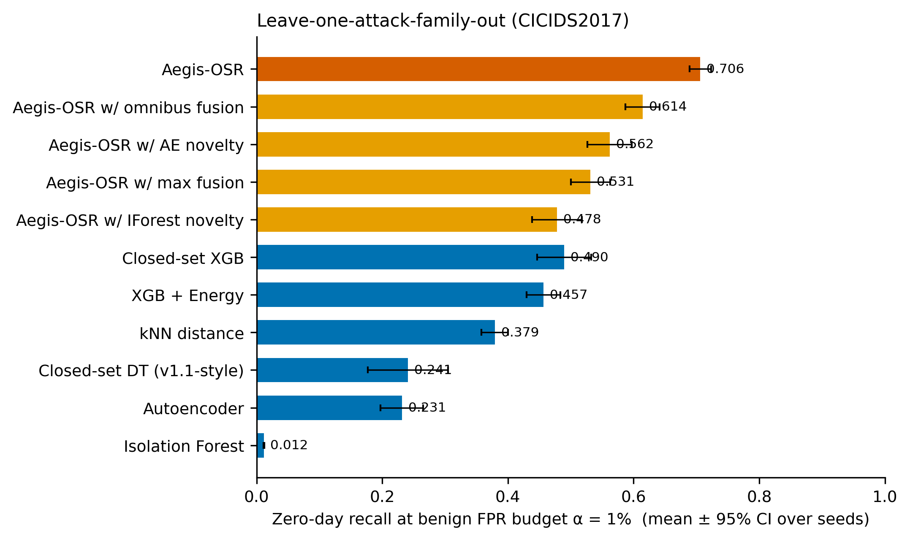
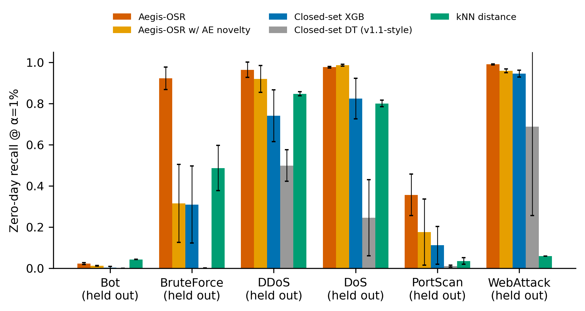
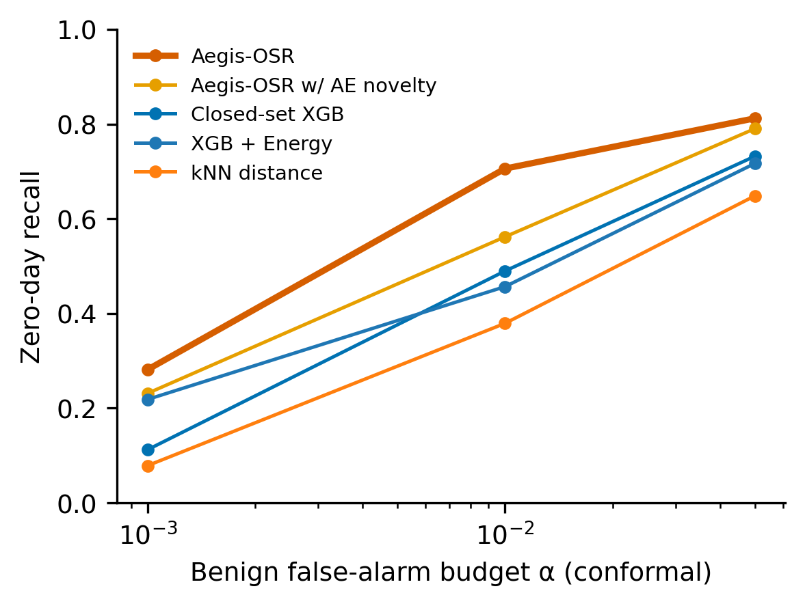
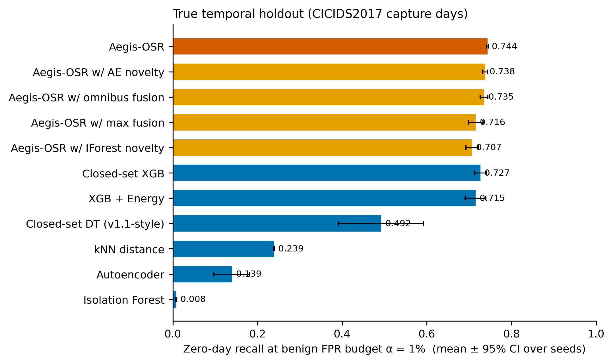
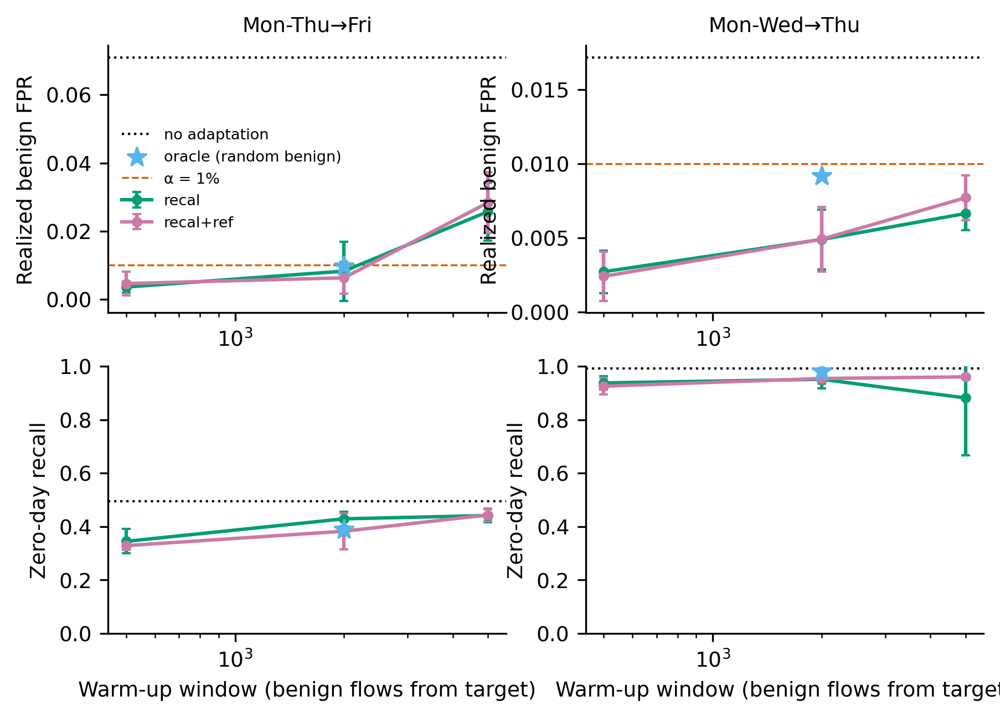
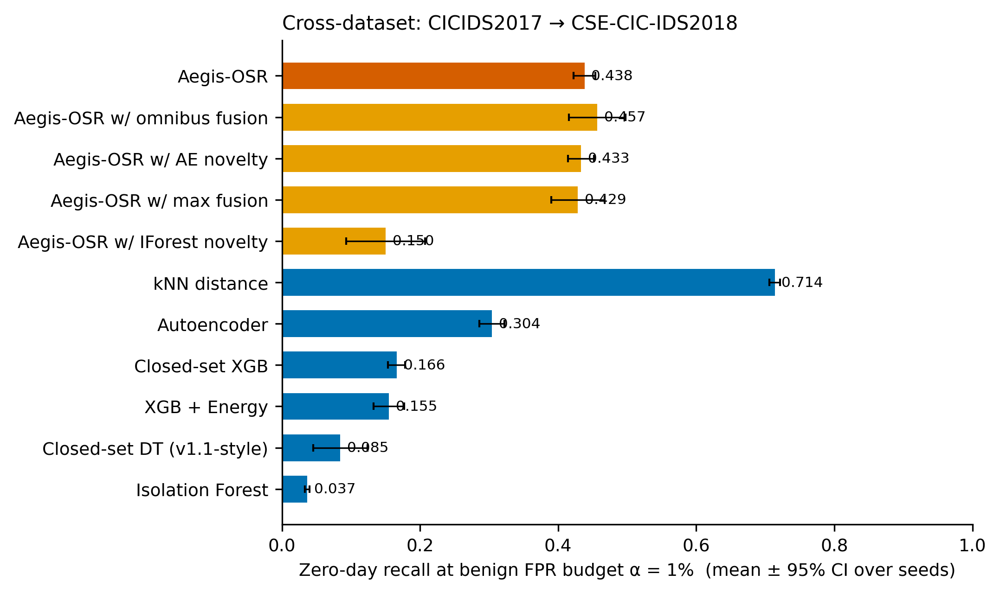
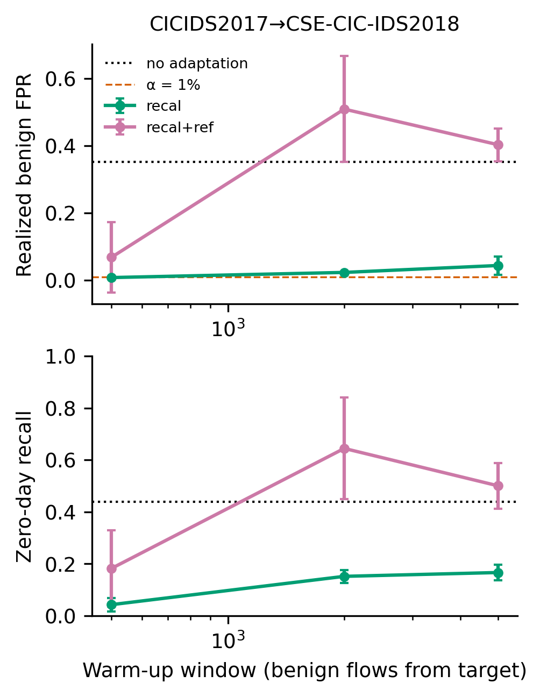
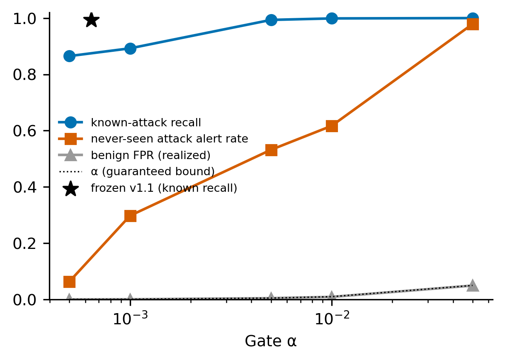

# Aegis-OSR — results (auto-generated)

_Generated 2026-11-10T11:54:12+00:00 by `scripts/55_research_figures.py`. Do not edit by hand — rerun the script._

Design selected on pilot seed 0; all numbers below use fresh seeds (see `meta`). α = 1% benign false-alarm budget unless stated; brackets are 95% t-intervals over seeds.

## Leave-one-attack-family-out (CICIDS2017)

Seeds: [1, 2, 3, 4, 5] · records: 30 · commit `775e9a9`

| Method | Group | Zero-day recall @1% | AUROC (unknown) | Known recall | Realized FPR |
|---|---|---|---|---|---|
| **Aegis-OSR** | proposed | 0.706 [0.689, 0.723] | 0.946 [0.943, 0.950] | 1.000 [0.999, 1.000] | 1.00% [0.92, 1.07] |
| Aegis-OSR w/ omnibus fusion | ablation | 0.614 [0.587, 0.642] | 0.946 [0.941, 0.951] | 1.000 [1.000, 1.000] | 0.99% [0.92, 1.06] |
| Aegis-OSR w/ AE novelty | ablation | 0.562 [0.527, 0.597] | 0.955 [0.952, 0.957] | 1.000 [1.000, 1.000] | 0.97% [0.88, 1.05] |
| Aegis-OSR w/ max fusion | ablation | 0.531 [0.500, 0.563] | 0.944 [0.939, 0.948] | 1.000 [1.000, 1.000] | 0.99% [0.95, 1.04] |
| Aegis-OSR w/ IForest novelty | ablation | 0.478 [0.438, 0.518] | 0.929 [0.924, 0.934] | 1.000 [1.000, 1.000] | 0.99% [0.96, 1.02] |
| Closed-set XGB | baseline | 0.490 [0.447, 0.533] | 0.938 [0.932, 0.945] | 1.000 [1.000, 1.000] | 1.00% [0.97, 1.02] |
| XGB + Energy | baseline | 0.457 [0.430, 0.484] | 0.947 [0.943, 0.952] | 1.000 [1.000, 1.000] | 1.00% [0.95, 1.04] |
| kNN distance | baseline | 0.379 [0.358, 0.401] | 0.866 [0.861, 0.871] | 0.546 [0.534, 0.559] | 1.01% [0.92, 1.11] |
| Closed-set DT (v1.1-style) | baseline | 0.241 [0.177, 0.305] | 0.606 [0.571, 0.640] | 0.999 [0.999, 0.999] | 0.31% [0.21, 0.42] |
| Autoencoder | baseline | 0.231 [0.197, 0.265] | 0.883 [0.870, 0.897] | 0.430 [0.397, 0.463] | 1.00% [0.86, 1.13] |
| Isolation Forest | baseline | 0.012 [0.011, 0.012] | 0.840 [0.829, 0.851] | 0.008 [0.007, 0.008] | 0.99% [0.92, 1.06] |

**Paired Wilcoxon signed-rank tests (pairs = fold × seed)**

| Aegis-OSR vs | Mean Δ zero-day recall | Wins / losses / ties | Wilcoxon p |
|---|---|---|---|
| Closed-set XGB | +0.216 | 30 / 0 / 0 | 1.86e-09 |
| Closed-set DT (v1.1-style) | +0.465 | 30 / 0 / 0 | 1.86e-09 |
| XGB + Energy | +0.249 | 30 / 0 / 0 | 1.73e-06 |
| Aegis-OSR w/ IForest novelty | +0.228 | 30 / 0 / 0 | 1.73e-06 |
| Isolation Forest | +0.694 | 27 / 2 / 1 | 3.69e-06 |
| Autoencoder | +0.475 | 27 / 3 / 0 | 4.73e-06 |
| Aegis-OSR w/ max fusion | +0.175 | 24 / 6 / 0 | 6.92e-06 |
| Aegis-OSR w/ AE novelty | +0.144 | 25 / 5 / 0 | 6.92e-06 |
| kNN distance | +0.327 | 25 / 5 / 0 | 7.68e-06 |
| Aegis-OSR w/ omnibus fusion | +0.092 | 24 / 6 / 0 | 1.11e-04 |

**Per fold (zero-day recall, realized FPR)**

| Fold | Aegis-OSR | Closed-set XGB | Aegis-OSR w/ AE novelty | Closed-set DT (v1.1-style) |
|---|---|---|---|---|
| Bot | 0.023 [0.019, 0.028] FPR 1.00% [0.94, 1.06] | 0.004 [-0.001, 0.009] FPR 0.98% [0.95, 1.02] | 0.012 [0.010, 0.015] FPR 0.96% [0.84, 1.08] | 0.000 [-0.000, 0.001] FPR 0.40% [0.05, 0.75] |
| BruteForce | 0.923 [0.869, 0.977] FPR 1.00% [0.91, 1.08] | 0.310 [0.123, 0.497] FPR 1.00% [0.93, 1.07] | 0.316 [0.126, 0.505] FPR 0.96% [0.88, 1.04] | 0.001 [0.000, 0.001] FPR 0.40% [0.13, 0.68] |
| DDoS | 0.965 [0.928, 1.002] FPR 0.99% [0.90, 1.09] | 0.742 [0.616, 0.867] FPR 1.00% [0.94, 1.07] | 0.920 [0.854, 0.985] FPR 0.97% [0.87, 1.08] | 0.499 [0.423, 0.576] FPR 0.54% [0.51, 0.57] |
| DoS | 0.977 [0.974, 0.980] FPR 1.00% [0.92, 1.08] | 0.824 [0.726, 0.923] FPR 1.00% [0.93, 1.07] | 0.987 [0.983, 0.991] FPR 0.94% [0.86, 1.03] | 0.246 [0.062, 0.430] FPR 0.12% [0.10, 0.15] |
| PortScan | 0.357 [0.257, 0.457] FPR 0.99% [0.92, 1.06] | 0.112 [0.020, 0.204] FPR 1.00% [0.98, 1.03] | 0.177 [0.016, 0.337] FPR 0.99% [0.90, 1.08] | 0.011 [0.007, 0.015] FPR 0.09% [0.08, 0.09] |
| WebAttack | 0.991 [0.989, 0.993] FPR 1.00% [0.90, 1.09] | 0.946 [0.930, 0.962] FPR 0.99% [0.93, 1.05] | 0.960 [0.951, 0.969] FPR 0.97% [0.91, 1.04] | 0.688 [0.256, 1.121] FPR 0.31% [0.14, 0.49] |

## True temporal holdout (CICIDS2017 capture days)

Seeds: [1, 2, 3, 4, 5] · records: 10 · commit `775e9a9`

| Method | Group | Zero-day recall @1% | AUROC (unknown) | Known recall | Realized FPR |
|---|---|---|---|---|---|
| **Aegis-OSR** | proposed | 0.744 [0.742, 0.746] | 0.912 [0.896, 0.928] | — | 4.40% [4.10, 4.71] |
| Aegis-OSR w/ AE novelty | ablation | 0.738 [0.732, 0.744] | 0.933 [0.924, 0.943] | — | 3.80% [3.09, 4.51] |
| Aegis-OSR w/ omnibus fusion | ablation | 0.735 [0.726, 0.744] | 0.910 [0.902, 0.918] | — | 9.21% [8.71, 9.70] |
| Aegis-OSR w/ max fusion | ablation | 0.716 [0.698, 0.733] | 0.906 [0.899, 0.914] | — | 9.62% [9.06, 10.17] |
| Aegis-OSR w/ IForest novelty | ablation | 0.707 [0.692, 0.721] | 0.911 [0.900, 0.922] | — | 2.45% [2.31, 2.59] |
| Closed-set XGB | baseline | 0.727 [0.712, 0.741] | 0.880 [0.843, 0.918] | — | 1.26% [1.19, 1.33] |
| XGB + Energy | baseline | 0.715 [0.690, 0.740] | 0.872 [0.839, 0.905] | — | 1.27% [1.22, 1.33] |
| Closed-set DT (v1.1-style) | baseline | 0.492 [0.392, 0.593] | 0.744 [0.696, 0.793] | — | 0.13% [-0.10, 0.36] |
| kNN distance | baseline | 0.239 [0.238, 0.240] | 0.778 [0.773, 0.783] | — | 9.91% [9.75, 10.08] |
| Autoencoder | baseline | 0.139 [0.097, 0.182] | 0.806 [0.777, 0.835] | — | 8.90% [7.61, 10.19] |
| Isolation Forest | baseline | 0.008 [0.006, 0.009] | 0.794 [0.773, 0.814] | — | 3.44% [3.22, 3.65] |

**Paired Wilcoxon signed-rank tests (pairs = fold × seed)**

| Aegis-OSR vs | Mean Δ zero-day recall | Wins / losses / ties | Wilcoxon p |
|---|---|---|---|
| Closed-set XGB | +0.017 | 10 / 0 / 0 | 1.95e-03 |
| Closed-set DT (v1.1-style) | +0.252 | 10 / 0 / 0 | 1.95e-03 |
| Isolation Forest | +0.736 | 10 / 0 / 0 | 1.95e-03 |
| Autoencoder | +0.604 | 10 / 0 / 0 | 1.95e-03 |
| kNN distance | +0.505 | 10 / 0 / 0 | 1.95e-03 |
| XGB + Energy | +0.029 | 10 / 0 / 0 | 1.95e-03 |
| Aegis-OSR w/ AE novelty | +0.006 | 10 / 0 / 0 | 1.95e-03 |
| Aegis-OSR w/ IForest novelty | +0.037 | 10 / 0 / 0 | 1.95e-03 |
| Aegis-OSR w/ omnibus fusion | +0.009 | 7 / 3 / 0 | 4.88e-02 |
| Aegis-OSR w/ max fusion | +0.028 | 6 / 3 / 1 | 1.45e-01 |

**Per fold (zero-day recall, realized FPR)**

| Fold | Aegis-OSR | Closed-set XGB | Aegis-OSR w/ AE novelty | Closed-set DT (v1.1-style) |
|---|---|---|---|---|
| Mon-Thu→Fri | 0.495 [0.488, 0.503] FPR 7.09% [6.66, 7.52] | 0.471 [0.442, 0.499] FPR 1.27% [1.23, 1.31] | 0.490 [0.484, 0.497] FPR 5.94% [4.82, 7.07] | 0.127 [-0.078, 0.333] FPR 0.16% [-0.18, 0.51] |
| Mon-Wed→Thu | 0.992 [0.987, 0.998] FPR 1.72% [1.15, 2.28] | 0.982 [0.980, 0.985] FPR 1.25% [1.14, 1.36] | 0.986 [0.979, 0.993] FPR 1.66% [0.92, 2.40] | 0.857 [0.844, 0.869] FPR 0.10% [-0.02, 0.21] |

**Label-light adaptation (no retraining)**

| Fold | Variant | Window | Zero-day recall | Realized FPR |
|---|---|---|---|---|
| Mon-Thu→Fri | oracle | 2000 | 0.390 [0.310, 0.469] | 0.97% [0.64, 1.30] |
| Mon-Thu→Fri | recal | 500 | 0.345 [0.299, 0.390] | 0.36% [0.19, 0.52] |
| Mon-Thu→Fri | recal | 2000 | 0.429 [0.402, 0.456] | 0.82% [-0.04, 1.69] |
| Mon-Thu→Fri | recal | 5000 | 0.441 [0.416, 0.467] | 2.57% [1.73, 3.42] |
| Mon-Thu→Fri | recal+ref | 500 | 0.329 [0.313, 0.345] | 0.46% [0.11, 0.80] |
| Mon-Thu→Fri | recal+ref | 2000 | 0.383 [0.316, 0.450] | 0.63% [0.16, 1.10] |
| Mon-Thu→Fri | recal+ref | 5000 | 0.444 [0.420, 0.468] | 2.84% [1.94, 3.73] |
| Mon-Wed→Thu | oracle | 2000 | 0.981 [0.966, 0.997] | 0.92% [0.48, 1.36] |
| Mon-Wed→Thu | recal | 500 | 0.938 [0.913, 0.962] | 0.27% [0.13, 0.42] |
| Mon-Wed→Thu | recal | 2000 | 0.951 [0.918, 0.985] | 0.49% [0.29, 0.69] |
| Mon-Wed→Thu | recal | 5000 | 0.882 [0.667, 1.096] | 0.67% [0.55, 0.78] |
| Mon-Wed→Thu | recal+ref | 500 | 0.926 [0.894, 0.957] | 0.24% [0.08, 0.41] |
| Mon-Wed→Thu | recal+ref | 2000 | 0.954 [0.934, 0.975] | 0.49% [0.27, 0.71] |
| Mon-Wed→Thu | recal+ref | 5000 | 0.961 [0.952, 0.969] | 0.77% [0.62, 0.92] |

## Cross-dataset: CICIDS2017 → CSE-CIC-IDS2018

Seeds: [1, 2, 3, 4, 5] · records: 5 · commit `775e9a9`

| Method | Group | Zero-day recall @1% | AUROC (unknown) | Known recall | Realized FPR |
|---|---|---|---|---|---|
| **Aegis-OSR** | proposed | 0.438 [0.423, 0.454] | 0.576 [0.570, 0.583] | 0.864 [0.842, 0.886] | 35.20% [32.15, 38.25] |
| Aegis-OSR w/ omnibus fusion | ablation | 0.457 [0.416, 0.498] | 0.594 [0.586, 0.601] | 0.921 [0.915, 0.926] | 39.91% [35.66, 44.16] |
| Aegis-OSR w/ AE novelty | ablation | 0.433 [0.414, 0.452] | 0.563 [0.551, 0.575] | 0.926 [0.923, 0.928] | 23.66% [21.43, 25.90] |
| Aegis-OSR w/ max fusion | ablation | 0.429 [0.390, 0.467] | 0.596 [0.579, 0.613] | 0.902 [0.893, 0.911] | 35.09% [34.46, 35.73] |
| Aegis-OSR w/ IForest novelty | ablation | 0.150 [0.093, 0.207] | 0.487 [0.478, 0.496] | 0.757 [0.681, 0.833] | 3.38% [1.63, 5.13] |
| kNN distance | baseline | 0.714 [0.706, 0.722] | 0.559 [0.550, 0.567] | 0.519 [0.516, 0.522] | 59.30% [59.05, 59.55] |
| Autoencoder | baseline | 0.304 [0.286, 0.322] | 0.550 [0.536, 0.564] | 0.514 [0.511, 0.517] | 27.38% [22.79, 31.96] |
| Closed-set XGB | baseline | 0.166 [0.154, 0.179] | 0.490 [0.477, 0.502] | 0.842 [0.815, 0.868] | 4.10% [1.92, 6.28] |
| XGB + Energy | baseline | 0.155 [0.133, 0.177] | 0.495 [0.483, 0.507] | 0.799 [0.744, 0.855] | 3.83% [3.07, 4.59] |
| Closed-set DT (v1.1-style) | baseline | 0.085 [0.045, 0.124] | 0.453 [0.406, 0.501] | 0.331 [0.281, 0.381] | 13.97% [5.16, 22.78] |
| Isolation Forest | baseline | 0.037 [0.033, 0.040] | 0.438 [0.419, 0.456] | 0.007 [0.006, 0.007] | 1.51% [0.99, 2.03] |

**Paired Wilcoxon signed-rank tests (pairs = fold × seed)**

| Aegis-OSR vs | Mean Δ zero-day recall | Wins / losses / ties | Wilcoxon p |
|---|---|---|---|
| Closed-set XGB | +0.272 | 5 / 0 / 0 | 6.25e-02 |
| Closed-set DT (v1.1-style) | +0.354 | 5 / 0 / 0 | 6.25e-02 |
| Isolation Forest | +0.402 | 5 / 0 / 0 | 6.25e-02 |
| Autoencoder | +0.134 | 5 / 0 / 0 | 6.25e-02 |
| kNN distance | -0.276 | 0 / 5 / 0 | 6.25e-02 |
| XGB + Energy | +0.283 | 5 / 0 / 0 | 6.25e-02 |
| Aegis-OSR w/ IForest novelty | +0.288 | 5 / 0 / 0 | 6.25e-02 |
| Aegis-OSR w/ omnibus fusion | -0.018 | 1 / 4 / 0 | 1.88e-01 |
| Aegis-OSR w/ AE novelty | +0.005 | 3 / 2 / 0 | 4.38e-01 |
| Aegis-OSR w/ max fusion | +0.010 | 2 / 3 / 0 | 1.00e+00 |

**Per fold (zero-day recall, realized FPR)**

| Fold | Aegis-OSR | Closed-set XGB | Aegis-OSR w/ AE novelty | Closed-set DT (v1.1-style) |
|---|---|---|---|---|
| CICIDS2017→CSE-CIC-IDS2018 | 0.438 [0.423, 0.454] FPR 35.20% [32.15, 38.25] | 0.166 [0.154, 0.179] FPR 4.10% [1.92, 6.28] | 0.433 [0.414, 0.452] FPR 23.66% [21.43, 25.90] | 0.085 [0.045, 0.124] FPR 13.97% [5.16, 22.78] |

**Label-light adaptation (no retraining)**

| Fold | Variant | Window | Zero-day recall | Realized FPR |
|---|---|---|---|---|
| CICIDS2017→CSE-CIC-IDS2018 | recal | 500 | 0.043 [0.017, 0.069] | 0.83% [0.66, 1.01] |
| CICIDS2017→CSE-CIC-IDS2018 | recal | 2000 | 0.152 [0.127, 0.177] | 2.36% [2.24, 2.49] |
| CICIDS2017→CSE-CIC-IDS2018 | recal | 5000 | 0.167 [0.138, 0.196] | 4.42% [1.71, 7.14] |
| CICIDS2017→CSE-CIC-IDS2018 | recal+ref | 500 | 0.183 [0.036, 0.329] | 6.88% [-3.56, 17.31] |
| CICIDS2017→CSE-CIC-IDS2018 | recal+ref | 2000 | 0.644 [0.449, 0.840] | 50.96% [35.21, 66.72] |
| CICIDS2017→CSE-CIC-IDS2018 | recal+ref | 5000 | 0.501 [0.412, 0.589] | 40.37% [35.49, 45.24] |

## Production Zero-Day Gate

| α | Benign FPR | Known-attack recall | Never-seen alert rate |
|---|---|---|---|
| 0.0005 | 0.032% | 0.8650 | 0.064 |
| 0.001 | 0.073% | 0.8925 | 0.298 |
| 0.005 | 0.466% | 0.9935 | 0.532 |
| 0.01 | 0.920% | 0.9988 | 0.617 |
| 0.05 | 4.943% | 1.0000 | 0.979 |

Frozen v1.1 reference: benign FPR 0.064%, known recall 0.9931, never-seen attack rate 0.000.

> Natural unknowns (Infiltration n=36, Heartbleed n=11) are tiny; treat rates as illustrative, the LOAFO / temporal / cross-dataset protocols are the statistical evidence.

## Frozen v1.1 on CSE-CIC-IDS2018 (EXP-009, no retraining)

Precision 0.992 · recall 0.102 · F1 0.185 · benign FPR 0.08% (IID CICIDS2017 F1 reference: None)

| 2018 label | Family | n | Alert rate | Family match |
|---|---|---|---|---|
| Benign | BENIGN | 143116 | 0.001 | — |
| Bot | Bot | 20000 | 0.000 | 0.000 |
| Brute Force -Web | WebAttack | 555 | 0.031 | 0.000 |
| Brute Force -XSS | WebAttack | 228 | 0.110 | 0.009 |
| DDOS attack-HOIC | DDoS | 20000 | 0.001 | 0.000 |
| DDOS attack-LOIC-UDP | DDoS | 1730 | 0.000 | 0.000 |
| DDoS attacks-LOIC-HTTP | DDoS | 20000 | 0.000 | 0.000 |
| DoS attacks-GoldenEye | DoS | 20000 | 0.274 | 0.274 |
| DoS attacks-Hulk | DoS | 20000 | 0.008 | 0.007 |
| DoS attacks-SlowHTTPTest | DoS | 55 | 0.709 | 0.000 |
| DoS attacks-Slowloris | DoS | 9908 | 0.956 | 0.956 |
| FTP-BruteForce | BruteForce | 51 | 0.686 | 0.686 |
| Infilteration | Infiltration | 20000 | 0.014 | 0.000 |
| SQL Injection | WebAttack | 84 | 0.024 | 0.000 |
| SSH-Bruteforce | BruteForce | 20000 | 0.000 | 0.000 |

> Frozen CICIDS2017 models transferred to a different network, year and CICFlowMeter version. Performance under this shift is the honest external-validity number; it is NOT comparable to the IID score and no retraining or threshold tuning was done on 2018 data.
